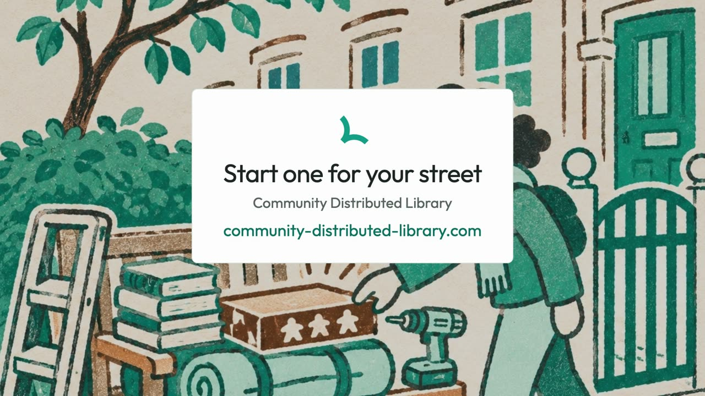

# Community Distributed Library

A community distributed library is a decentralized sharing network: neighbours lend each other
what they already own. Items stay in the homes of their owners, with no building and no central
stock, until someone asks for one. The library is the shared part: a
catalogue, requests, handoff times picked from both people's week, a record of who holds what, and
reminders.

[](https://community-distributed-library.com/open-a-library)

[Watch the one-minute video](https://community-distributed-library.com/open-a-library) on what a
library is and how to open one for your street.

What you can do next:

- **Run a library** for your street. Follow [docs/self-hosting.md](docs/self-hosting.md), or open
  this folder in Claude Code and type `/open-a-library`. You need a domain on Cloudflare and a
  Cloudflare API token; one command does the rest.
- **Work on the code.** Start at [Run locally](#run-locally), and read
  [CONTRIBUTING.md](CONTRIBUTING.md) for how changes are made here.
- **Build on a library.** Everything the web app does is also open as an
  [API, MCP server and webhooks](#api-mcp-and-webhooks).

Released into the public domain under [the Unlicense](LICENSE).

## One codebase, many libraries

One codebase runs any number of libraries. Each library is its own deployment on Cloudflare, with its
own members, data and address; the person who runs one or more of them is its **operator**. A library
lends either **books** or **things** (`packages/contracts/src/library-types.ts`). Libraries are
invite-only and closed to search engines. Everything runs on Cloudflare, email included.

## Layout

npm workspaces. Each service is its own Cloudflare Worker with its own storage, and services talk
over service bindings.

```
apps/web/             the library web app: Next.js App Router on vinext, a PWA, one Worker per library
apps/landing/         the front page at the bare domain (static)
apps/video/           the explainer video, landscape and portrait (Remotion); not deployed
services/core/        system of record and the public /v1 API (Hono, D1)
services/mcp/         OAuth 2.1 server and MCP tools for AI assistants, calling core's /v1
services/notify/      email through Cloudflare Email Sending, Web Push (RFC 8291/8292); no storage
services/convo/       loan message threads, own D1, deleted 90 days after a loan closes
services/metadata/    ISBN lookup (Open Library, then Google Books) and its cache; shared
services/reports/     where browsers report CSP violations and network errors; shared
packages/contracts/   Zod schemas, the OpenAPI document, library types
packages/tools/       what an assistant can do: one list of tools, for MCP and the pages (WebMCP)
packages/design/      design tokens, logo, principles, frontend conventions
scripts/              list of libraries, deploy, checks, local dev, pulling a database down
```

Naming: shared things say `cdl` (`@cdl/*`, `cdl-metadata`, `cdl-reports`, `cdl-landing`); a
library's own Workers and stores are `<slug>-<service>`, for example `our-street-core`.

## Run locally

Node version is in `.nvmrc`.

```sh
npm install
npm run dev        # applies migrations, then API :8787, MCP :8788, web :3000
npm run db:seed    # in a second terminal, once: one library and two members
```

Open <http://localhost:3000/login> and sign in as `dana@example.com` (admin, English) or
`sam@example.com` (member, Hebrew). Locally the API runs with `DEV_AUTH`, so the form goes straight to
the sign-in link instead of emailing it. Scripts can also send `X-Member-Id: <member id>`.

| Command                                                 | Does                                                                                                          |
| ------------------------------------------------------- | ------------------------------------------------------------------------------------------------------------- |
| `npm run db:seed:things`                                | Switches the local library to things and lists a few                                                          |
| `npm run library:books` / `npm run library:things`      | Switches the local library type                                                                               |
| `npm run db:pull -- core --library <slug>`              | Replaces a local database with a production copy; tokens and sessions are removed (stop the dev server first) |
| `services/core/scripts/role.sh <email> moderator`       | Gives a role locally (`--remote <slug>` for a live library)                                                   |
| `npm run dev:api`, `npm run dev:mcp`, `npm run dev:web` | Runs one side alone                                                                                           |
| `npm run dev` in `apps/landing`                         | The front page on :3001                                                                                       |

The local databases are `cdl-core`, `cdl-convo` and `cdl-metadata`, whichever library you pull.

## Check

```sh
npm run typecheck
npm test               # vitest everywhere; core runs in workerd against a migrated D1
npm run test:e2e -w @cdl/web   # Playwright: phone, desktop and things projects, axe in both languages
npm run format         # Prettier; CI fails on any diff
npm run check:libraries
```

`npm test` first runs `scripts/check-hosts.mjs`, which makes sure no Worker serves on `workers.dev` or
a preview URL. The browser tests switch the local library to books, run the things project last, and
leave it lending books; `npm run library:things` puts it back if you were working on things.

CI (`.github/workflows/ci.yml`) runs on every push and pull request, in two jobs: one runs types,
Prettier, typecheck, the builds, the library check and every test; the other runs the browser tests against a
local stack. CI does not deploy.

## Deploy

The `wrangler.jsonc` files describe one library for local development, with Workers named `cdl-*`.
The libraries you run are listed in the **manifest**: `libraries.json` at the repository root, or the
file `CDL_LIBRARIES` names. It holds each library's slug, address, sender, push public key, D1
database IDs and OAuth KV namespace, plus the Cloudflare account and the shared Workers' database and
addresses. `libraries.example.json` shows every field. Libraries are listed in release order: the
first one gets every release first.

A deploy writes one full config per library and Worker next to its template
(`<dir>/wrangler.<slug>.json`, ignored by git) and deploys that file. Credentials come from `.env`
at the repository root (never committed).

```sh
set -a; . ./.env; set +a
npm run deploy -- all web          # one service, every library
npm run deploy -- all core web     # after changing contracts or core
npm run deploy -- our-street       # every service, one library
npm run deploy -- shared           # metadata, reports and the landing page
```

The script checks the manifest first. Then, for each library in turn, it takes the Workers in binding
order, notify, convo, core, mcp and web, and for each one applies its remote database migrations and
deploys it. A failure stops that library before any later Worker of it deploys; the other libraries
still go, and the run ends in failure.

`npm run check:libraries` refuses a manifest that gives two libraries one Worker, route, database,
bucket, KV namespace or push key, and any library config still carrying a local development value.

To run wrangler by hand against a library, write its config first:
`npx wrangler d1 execute our-street-core --remote -c "$(node scripts/config.mjs our-street core)" --command "SELECT 1"`.

### Secrets and sending

| Where                     | What                                                                                               | How                                                                                                         |
| ------------------------- | -------------------------------------------------------------------------------------------------- | ----------------------------------------------------------------------------------------------------------- |
| `<slug>-notify`           | `VAPID_PRIVATE_JWK`, the library's private push key                                                | `npx wrangler secret put VAPID_PRIVATE_JWK -c "$(node scripts/config.mjs <slug> notify)"`                   |
| `<slug>-core` (optional)  | `INVITE_KEY`, any long random text: lets whoever made an invite link see it again while it is open | `openssl rand -base64 32 \| npx wrangler secret put INVITE_KEY -c "$(node scripts/config.mjs <slug> core)"` |
| the sender's domain       | Cloudflare Email Sending turned on; the `EMAIL` binding sends through it                           | `npx wrangler email sending enable <domain>`                                                                |
| `cdl-metadata` (optional) | `GOOGLE_BOOKS_KEY`, for more covers                                                                | `npx wrangler secret put GOOGLE_BOOKS_KEY -c "$(node scripts/config.mjs shared metadata)"`                  |

Only a hash of an invite link's token lets people in. With `INVITE_KEY` set, core also keeps a copy
sealed under that key (AES-GCM), so the member or moderator who made a link can show it again, copy
it or print its code while it is open. The database and its backups cannot open the copy; without the
key a link is shown once. `npm run provision` sets a key for a new library.

## API, MCP and webhooks

Everything the web app does goes through core's `/v1` API, and so can anyone else.

- **REST:** `https://<library host>/api/v1/...` with `Authorization: Bearer <token>`. Personal tokens
  are made on `/connect`. The browser cookie never authorises an API call. The OpenAPI 3.1 document is
  at `/api/v1/openapi.json`, generated from `packages/contracts/src/openapi.ts`; add a route there
  when you add one to core.
- **MCP:** `https://mcp.<library host>/mcp` (local `http://localhost:8788/mcp`). The client registers
  itself, the member approves scopes in the web app, and tools call `/v1` with that token. Scopes:
  `catalogue:read shelf:read shelf:write loans:read loans:write messages:read messages:write
profile:read admin`.
- **Webhooks:** subscribe on `/connect`. Signed `POST`s
  (`x-cdl-signature: t=…,v1=HMAC-SHA256(secret, t.body)`) for `copy.*`, `loan.*` and `handoff.*`,
  retried with backoff, replayable from `/api/v1/events?since=<id>`.

Member tools: `my_profile`, `whats_new`, `search_catalogue`, `browse_shelves`, `get_work`, `lookup_isbn`,
`list_tags`, `list_my_shelf`, `add_copy`, `update_copy`, `upload_cover`, `set_cover`,
`set_item_tags`, `request_loan`, `respond_to_request`, `cancel_loan`, `extend_loan`, `nudge`,
`list_my_loans`, `get_loan_messages`, `post_loan_message`, `join_waitlist`, `leave_waitlist`,
`my_waitlist`, `propose_tag`, `my_tag_proposals`, `report_problem`, `invite_neighbour`,
`my_invites`, `set_lend_limit`, `set_loan_length`.

Moderators also get `edit_item`, `set_item_cover`, `upload_item_cover`, `remove_item_cover`,
`add_tag`, `edit_tag`, `remove_tag`, `rename_tag_group`.

No tool can confirm a handoff or mark an item handed over or returned: a person has to be there.

Nothing wakes an assistant, so it hears news in passing. `whats_new` lists what the library told the
member since that connection last looked (`GET /v1/me/news`), and every other tool's answer ends with
a count of what is new, said once (`POST /v1/me/news/hint`): counts only, never what a notice says.
A member who wants to be told without asking gives their assistant a scheduled task that calls
`whats_new`.

## How some things work

- **Notifications.** Push first; the email follows five minutes later only if the member has not
  opened the app (`services/core/src/notify.ts`). Without push, email at once. A new loan request
  reaches its owner five minutes after it is made, so the asker can still take it back unheard; a
  nudge or a message on it waits for it too. To rotate a library's VAPID keys, set a new pair and
  clear `push_subscriptions`; every browser subscribes again.
- **Scheduled work.** core: reminders and escalation at 08:00 UTC; held requests, webhook and email
  delivery every minute; backup and cover rehosting at 03:20. convo: thread purge at 04:15.
- **Backups.** A SQL snapshot of `<slug>-core` goes to the private `<slug>-backups` bucket nightly,
  kept 30 days; moderators can take one with `POST /v1/admin/backup`. D1 Time Travel covers the same
  30 days.
- **Images.** Covers and photos are re-encoded in the browser (no metadata), stored in
  `<slug>-images` and served at `images.<library host>`. External covers are copied in nightly.
- **Location.** A member's area is snapped to a ~300 m cell; maps draw circles, never pins. The
  private meeting place a member writes is shown only to the borrower of an agreed handoff. Map tiles
  are OpenStreetMap through Leaflet.
- **Languages.** English and Hebrew, chosen per library. CSS uses logical properties only, so one
  layout serves both directions (`packages/design/frontend-conventions.md`).

## Expectations

Every change to what a library does for someone ships with an expectation (skill:
production-expectations). [docs/expectations.md](docs/expectations.md) is the record.

- They live in: `services/core/src/checks.ts`, one count that should be 0 each.
- They run: every 15 minutes per library, from core's every-minute cron (`runChecks`).
- A failure goes to: a critical check logs `check.failed <name>` → Workers Issues → the ops relay
  → email to the library's admins and the operator. Others go to the weekly digest.
- Owner: `owner` in the manifest (`libraries.json`, not in git), told of every failure by email.
- The record: `docs/expectations.md`. Incident records: `docs/incidents/`, not in git.
- Never in git: library slugs and hosts, Worker names, production ids (Issue, version, trace,
  ray) and anything about a requester. The repo is public; these go in the incident record.
- Release ids and times come from: the Worker version id (`version` in every log event) and
  **Workers & Pages → Deployments**.
- Switches: none but the release; roll the Worker back.
- An alert is acknowledged by: its Workers Issue staying open (it emails on the first occurrence
  only); resolving it re-arms it.
- The owner looks first at: their inbox (`owner.email`).
- On call: nobody. An agent does only what `docs/runbooks/README.md` (Bounds) allows.
- Never stored or logged: names, emails, meeting places, message text, search terms. Ids and counts
  only; member ids hashed per library.
- Not set up yet: first runs recorded by hand; a way to acknowledge in the ops store.

## Status

Built: invite-only sign-in (links to share or scan, and one-day event links with a printable sign),
catalogue with tags and filters, requests, handoffs with codes, relays,
waitlists, wishlists, wanted books, extensions, reminders, reports and moderation, push and email,
API, MCP and webhooks, books and things libraries with sets, and in a library of things asks
("a saw, today": neighbours offer theirs, listed or not, and one offer becomes a loan).

Not built: drop points, reputation, blocks.
