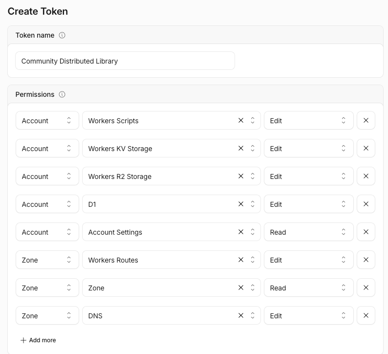
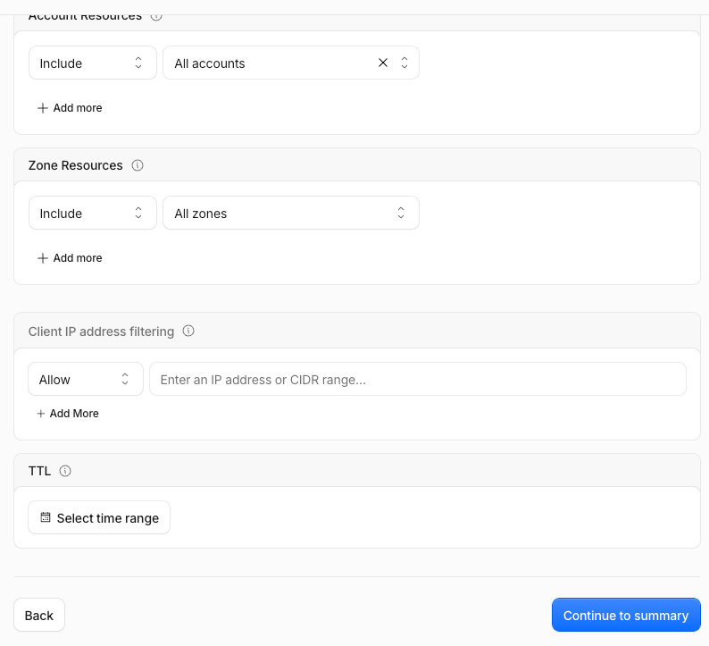
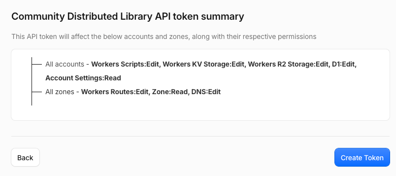
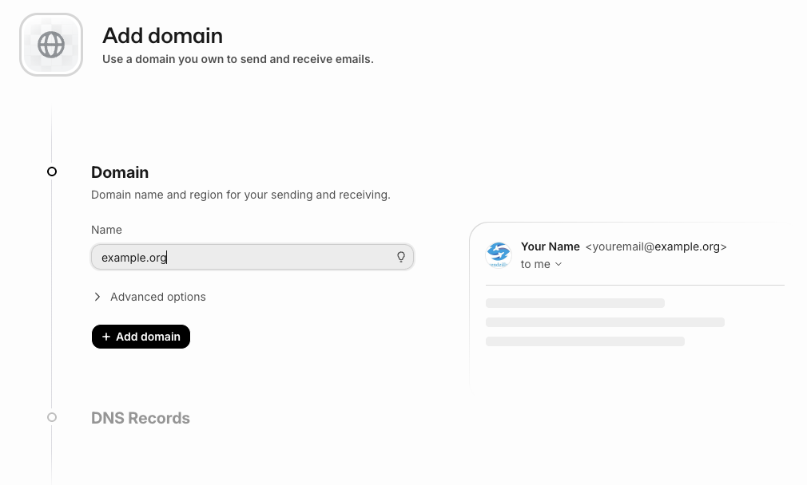
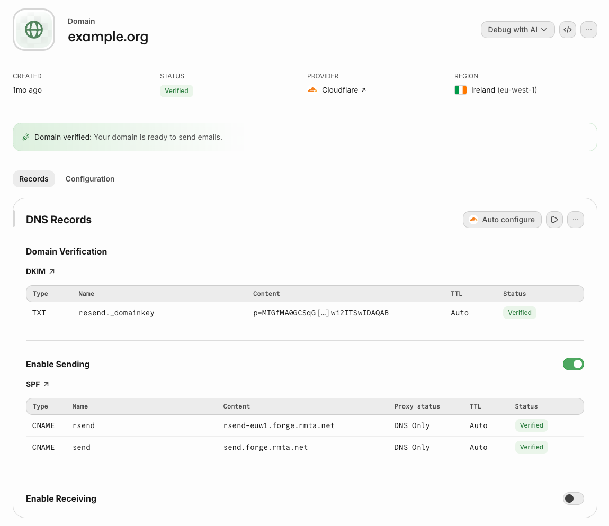
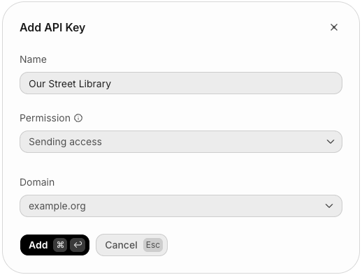

# Run your own library

> **Using Claude Code?** Open this folder in it and type `/open-a-library`. It walks you through
> every step below, checks your keys without showing them, and opens the library for you.

This guide opens a library on your own domain, in your own Cloudflare account. It takes about half
an hour, most of it waiting for email settings to check out. You need two keys, one from Cloudflare
and one from Resend; one command does the rest.

## What you need

- A domain whose DNS is on Cloudflare, for example `example.org`. Your library will live at a name
  under it, such as `our-street.example.org`.
- A Cloudflare account with the **Workers Paid** plan (US$5 a month). The free plan gives each
  request 10 ms of processing; drawing a page of the library often takes more, so on the free plan
  many pages would fail. Paid also allows the library's scheduled jobs.
- A [Resend](https://resend.com) account, free for up to 3,000 emails a month. Sign-in links and
  reminders are sent through it.
- [Node.js](https://nodejs.org) (the version in `.nvmrc`) and git.

## 1. Get the code

```sh
git clone https://github.com/omrilotan/community-distributed-library.git
cd community-distributed-library
npm install
```

## 2. Make a Cloudflare API token

1. Sign in to Cloudflare, then open
   [this link](https://dash.cloudflare.com/profile/api-tokens?permissionGroupKeys=%5B%7B%22key%22%3A%22workers_scripts%22%2C%22type%22%3A%22edit%22%7D%2C%7B%22key%22%3A%22workers_kv_storage%22%2C%22type%22%3A%22edit%22%7D%2C%7B%22key%22%3A%22workers_r2%22%2C%22type%22%3A%22edit%22%7D%2C%7B%22key%22%3A%22d1%22%2C%22type%22%3A%22edit%22%7D%2C%7B%22key%22%3A%22account_settings%22%2C%22type%22%3A%22read%22%7D%2C%7B%22key%22%3A%22workers_routes%22%2C%22type%22%3A%22edit%22%7D%2C%7B%22key%22%3A%22zone%22%2C%22type%22%3A%22read%22%7D%2C%7B%22key%22%3A%22dns%22%2C%22type%22%3A%22edit%22%7D%5D&accountId=*&zoneId=all&name=Community%20Distributed%20Library).
   It opens a new token with every permission already filled in. Check that it lists these eight:

   

2. Scroll down. Leave **All accounts** and **All zones** as they are, or pick your account and your
   domain to narrow the token. Select **Continue to summary**.

   

3. Select **Create Token**.

   

4. Cloudflare shows the token once. Copy it now.

## 3. Make a Resend API key

1. In Resend, open **Domains** and select **Add domain**. Enter your domain, for example
   `example.org`, and select **Add domain** under it.

   

2. Resend lists a few DNS records. Select **Auto configure** to have Resend add them to Cloudflare
   for you, or add each one by hand under your domain's **DNS** > **Records** in Cloudflare. It can
   take a few minutes for every record to say **Verified**.

   

3. Open **API keys** and select **Create API key**. Name it after your library, set **Permission** to
   **Sending access** and **Domain** to your domain, then select **Add**.

   

4. Resend shows the key once. Copy it now.

## 4. Keep both keys in `.env`

Make a file called `.env` in the repository's folder. Git ignores it, so it never leaves your
computer.

```sh
CLOUDFLARE_API_TOKEN=paste-the-cloudflare-token-here
RESEND_API_KEY=paste-the-resend-key-here
```

If your Cloudflare token reaches more than one account, add `CLOUDFLARE_ACCOUNT_ID=` with the one to
use. The command in the next step tells you if it needs it.

## 5. Check your setup

```sh
set -a; . ./.env; set +a
npm run check:setup -- --host our-street.example.org
```

Every line should start with ✓. Each ✗ says what to fix. It never prints your keys.

## 6. Open the library

Pick:

- a **slug**: a short name in lowercase letters and dashes, such as `our-street`. Cloudflare names
  everything of this library after it.
- the **address** it will live at, such as `our-street.example.org`
- its **name**, as members will see it
- its **centre**: the latitude and longitude of the middle of your neighbourhood. On
  [openstreetmap.org](https://www.openstreetmap.org), right-click the spot and choose **Show
  address**; the numbers are at the top of the panel.
- what it lends: `books` or `things`
- **your email address**: you become the library's first admin

Then run:

```sh
npm run provision -- our-street \
  --host our-street.example.org \
  --name "Our Street Library" \
  --centre 51.6012,-0.1924 \
  --type books \
  --admin you@example.org
```

It makes the library's databases, storage and Workers, gives it its own push key and addresses,
and makes you its admin. If it stops halfway, fix what it says and run the same command again: it
keeps what it already made.

When it finishes, open your library's address and sign in with your email. In **Moderation** >
**Settings** you can give it a description, its languages and a colour, and invite your first
neighbours.

## Keep these safe

- `libraries.json`: the list of your libraries and what each one owns in Cloudflare. Every later
  deploy reads it. Keep it in your own private repository or back it up.
- `.keys/<slug>.vapid.json`: the library's private push key. Cloudflare keeps a copy it will not show
  you again; without this file you cannot move the library elsewhere without asking every member's
  phone to subscribe again.
- `.env`: your two keys.

## Update

```sh
git pull
npm install
set -a; . ./.env; set +a
npm run deploy -- shared metadata
npm run deploy -- all
```

Database changes are applied before the new code goes live.

## Another library

Run `npm run provision` again with a different slug and address. Each library has its own members,
books and data, and none of them can see another's.

## Optional

- **No nightly backup.** Each library saves a snapshot of its database to a private R2 bucket every
  night. To skip that, add `--no-backups` to `npm run provision`, or set `"backups": false` on the
  library in `libraries.json` and run `npm run deploy -- <slug> core`.

- **Book covers from Google Books.** Lookups use Open Library, then Google Books. With a
  [Google Books API key](https://developers.google.com/books/docs/v1/using#APIKey) there are more
  covers:
  `npx wrangler secret put GOOGLE_BOOKS_KEY -c "$(node scripts/config.mjs shared metadata)"`.
- **Replies to the library's emails.** Mail is sent from `<slug>@<your domain>`. To receive replies
  and contact-form copies, add a rule for that address in Cloudflare **Email Routing**.
- **Error reports.** Add `"reports": { "host": "reports.example.org", "zone": "example.org" }` under
  `shared` in `libraries.json`, then `npm run deploy -- shared reports` and `npm run deploy -- all web`.
  Browsers then report blocked content and network errors there.
